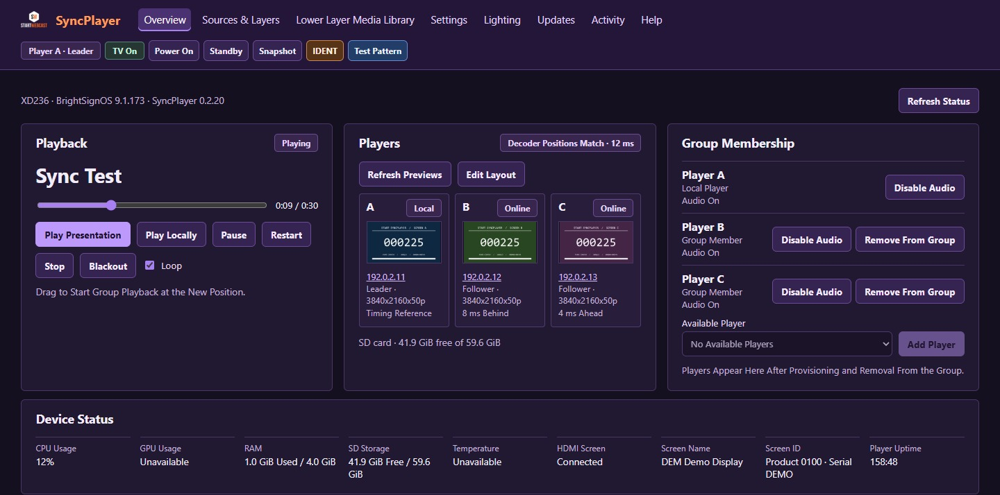
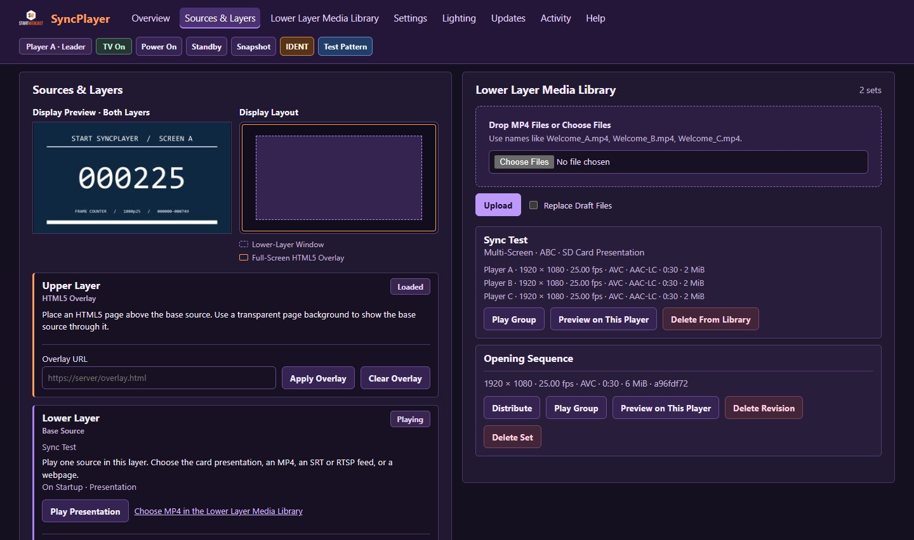
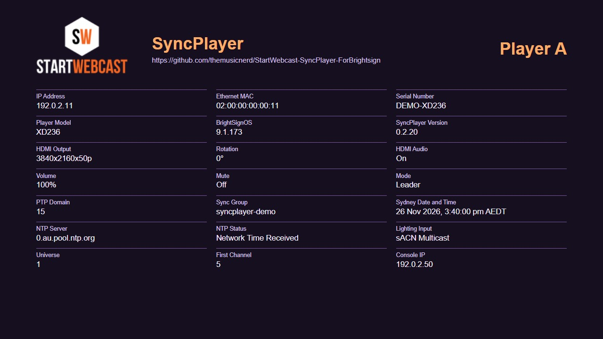
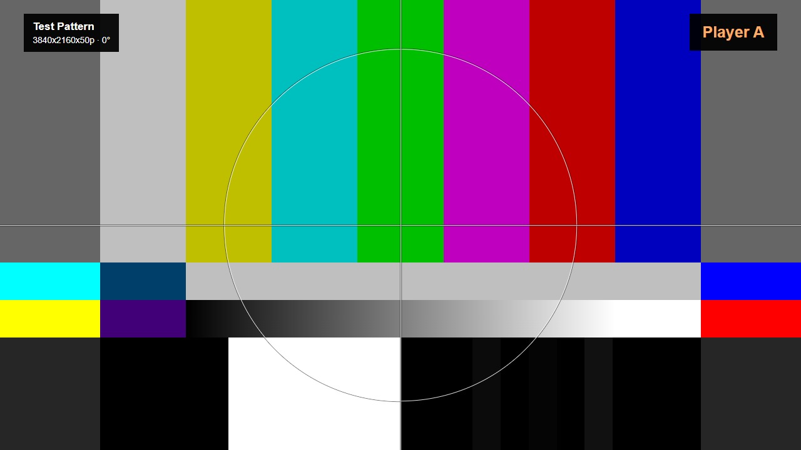

# StartWebcast SyncPlayer

SyncPlayer turns BrightSign XD236 players into a standalone media player or a wired, multi-screen playback group. Each screen plays its own local file. Use a browser on your LAN to control playback, distribute media and monitor the players.

[**Download the Latest Release**](https://github.com/themusicnerd/StartWebcast-SyncPlayer-ForBrightsign/releases/latest) · [SD Card Install](docs/SD-INSTALL.md) · [Console and API Guide](docs/SUITE.md) · [Updates](docs/UPDATES.md)



## What You Can Do

- **Play and sync.** Run a player on its own or use native PTP and SyncManager for a wired A/B/C group. Pause, resume and seek from the console. Move the group playhead from any included player.
- **Manage media.** Upload matching MP4s in one batch. Player suffixes such as `_A`, `_B` and `_C` assign each cut to its screen. Preview locally or distribute a verified revision to the group.
- **Compose two layers.** Play MP4, SRT, RTSP or a webpage in the lower layer. Resize its window and add a full-screen HTML5 overlay above it. Save stream addresses and choose a local fallback clip.
- **Monitor and control.** Arrange display previews in a shared layout. Check decoder timing estimates, SD storage and HDMI screen identity. Show IDENT or local colour bars, adjust audio and use HDMI-CEC for display power.
- **Automate and update.** Use the authenticated REST API, HDMI-CEC transport or Art-Net and sACN inputs. Stage signed app updates from a local file or a GitHub branch.

## Install on an XD236

1. Download the **SD Install ZIP** from the latest release and extract it. It includes the generated **Sync Test** media and the public app-update verification key.
2. Follow `START-HERE.md` to provision web access. Copy the contents of the matching **PlayerA**, **PlayerB** or **PlayerC** folder to the root of its microSD card.
3. Insert the card and power on the player. Open the SyncPlayer console at `https://<player-ip>:8080/` from the same LAN.

| Player | Demo Role | Default IP |
| --- | --- | --- |
| A | Leader | `192.168.1.11` |
| B | Follower | `192.168.1.12` |
| C | Follower | `192.168.1.13` |

Use **Updates → Fetch and Stage** on a commissioned player to fetch the signed build from GitHub. Use the signed `.swu` file for an offline app update. [SD Install Guide](docs/SD-INSTALL.md) · [Content Card Guide](docs/CONTENT-CARDS.md) · [App Update Guide](docs/UPDATES.md)

## Screenshots

The screenshots use the live interface with demo data and the bundled Sync Test media.

### Sources and Media Library



### IDENT and Test Pattern

| IDENT | Test Pattern |
| --- | --- |
|  |  |

## Documentation

- [Console, Playback and REST API](docs/SUITE.md)
- [SD Card Install and Commissioning](docs/SD-INSTALL.md)
- [Native Sync Architecture](docs/ADR-001-NATIVE-SYNC.md)
- [Hardware Verification and Test Evidence](docs/API_VERIFICATION.md)
- [Hardware Acceptance Checklist](docs/HARDWARE_TEST.md)
- [Changelog](CHANGELOG.md)

Use matching video timings, output modes and BrightSignOS versions across a group. The console estimates decoder position differences from reports. HDMI output alignment requires a separate measurement. [Hardware Acceptance Checklist](docs/HARDWARE_TEST.md)

## Build From Source

Install Python 3.11 or newer, FFmpeg and Node.js on the workstation.

```powershell
python tools/build_sd_release.py
python tools/build_release.py
python -m unittest discover -s tests/desktop
python tools/test_native_mocks.py
node --test tests/desktop/*.test.js
```

`build_sd_release.py` builds the copy-to-card installer. `build_release.py` generates the separate native-sync bench archive used by the Python release checks.
